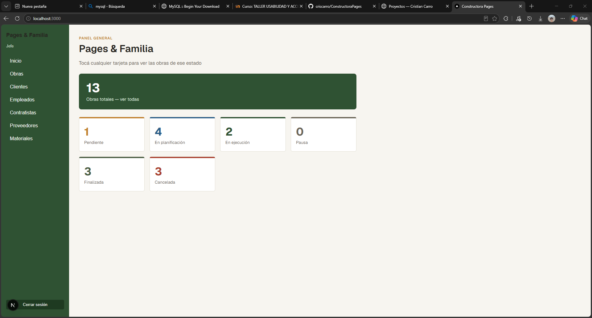
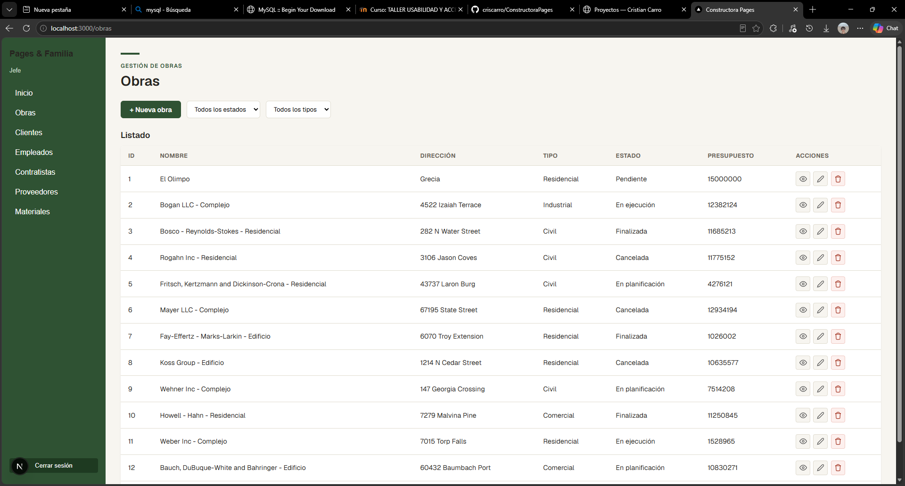
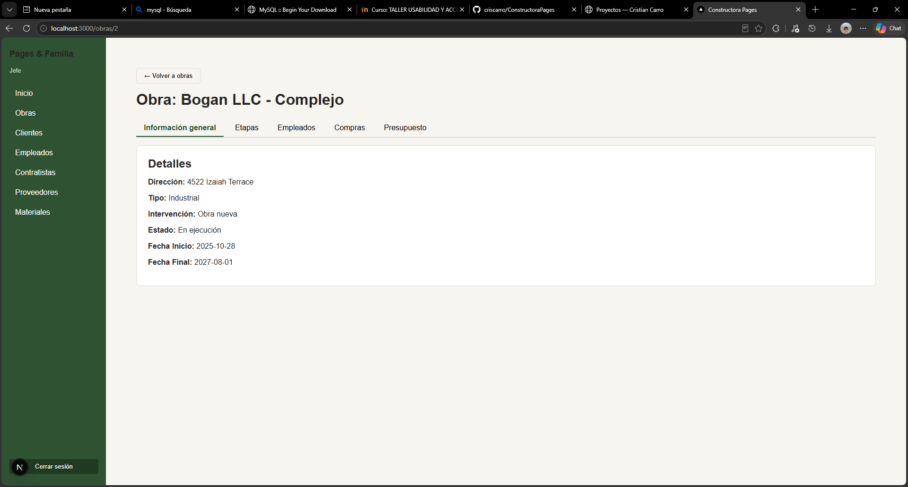

# Pages & Familia — Sistema de Gestión para Constructora

Sistema web para gestionar las obras de una empresa constructora: clientes, obras, etapas de cada obra y seguimiento de costos.

Proyecto desarrollado por **Cristian Carro** y **Alen Ravel** como parte de la carrera de Analista Programador (CTC, Uruguay).


<!-- Reemplazá con una captura real de la app -->

---

## ✨ Funcionalidades

- **Obras**: alta, baja, modificación y listado de obras
- **Etapas de obra**: cada obra se divide en etapas con su propio seguimiento
- **Clientes**: gestión de clientes y su relación con una o varias obras
- **Costos**: el costo actual de cada obra se calcula a partir de sus etapas, sin guardarse duplicado
<!-- Ajustá o agregá según lo que tenga la app -->

---

## 🛠️ Stack

| Capa | Tecnología |
|------|-----------|
| Frontend | Next.js (React) |
| Backend | C# / ASP.NET Core Web API |
| Base de datos | SQL Server (13 tablas) |

**Estructura del repo**
- `frontend/` → app en Next.js
- `database/` → scripts SQL de la base (13 tablas)
- Backend (API): [link al repo de la API] <!-- completar o borrar si no está subida -->
<!-- Ajustá los nombres de carpeta a los reales -->

---

## 🏗️ Arquitectura

**Backend**: API REST con arquitectura en capas:

```
Dominio/        → Entidades y reglas de negocio
Persistencia/   → Acceso a datos (SQL Server)
Controllers/    → Endpoints REST
Enums/          → Tipos y estados del sistema
```

**Base de datos**: 13 tablas diseñadas de forma iterativa. Algunas decisiones de diseño:
- Se resolvió una dependencia circular de claves foráneas entre `Obra` y `EtapaObra`
- Relación muchos a muchos entre obras y clientes mediante `ObraCliente`
- `costo_actual` se calcula en vez de almacenarse, para evitar inconsistencias

---

## 🚀 Cómo correrlo localmente

### Requisitos
- Node.js 18+
- .NET SDK [versión] <!-- completar -->
- SQL Server

### Base de datos
Ejecutar los scripts de `database/` en SQL Server.

### Backend
```bash
git clone [link al repo de la API]
cd [carpeta]
# Configurar el connection string en appsettings.json
dotnet run
```

### Frontend
```bash
git clone https://github.com/criscarro/ConstructoraPages.git
cd ConstructoraPages/frontend
npm install
npm run dev
```

La app queda disponible en `http://localhost:3001`.

---

## 📸 Capturas

| Listado de obras | Detalle de obra |
|---|---|
|  |  |
<!-- Agregá 2–4 capturas en una carpeta docs/ -->

---

## 📄 Documentación

El proyecto incluye documentación de Ingeniería de Software con historias de usuario (formato Dado / Cuando / Entonces) y requisitos no funcionales medibles.

---

## 👥 Autores

- **Cristian Carro**: [GitHub](https://github.com/criscarro) · [Portfolio](https://criscarro.github.io/Portfolio/)
- **Alen Ravel**: [GitHub](#) <!-- completar -->
